# 甘肃非物质文化网站的设计与开发

> 🎓 **计算机毕业设计 · 甘肃非物质文化网站的设计与开发**
>
> 本仓库只放**项目介绍 + 运行截图**（截图是站点带水印的原图，存在仓库 `images/` 里）。
>
> 👉 **完整可运行源码 / 数据库脚本 / 部署文档：[点我获取](https://geekcode.top/archives/%E7%94%98%E8%82%83%E9%9D%9E%E7%89%A9%E8%B4%A8%E6%96%87%E5%8C%96%E7%BD%91%E7%AB%99%E7%9A%84%E8%AE%BE%E8%AE%A1%E4%B8%8E%E5%BC%80%E5%8F%91?utm_source=github)**
>
> 💬 咨询微信：**ir9372**　|　🌐 更多项目：[极客代码 geekcode.top](https://geekcode.top/?utm_source=github)
>
> 📌 项目详情页：<https://geekcode.top/archives/%E7%94%98%E8%82%83%E9%9D%9E%E7%89%A9%E8%B4%A8%E6%96%87%E5%8C%96%E7%BD%91%E7%AB%99%E7%9A%84%E8%AE%BE%E8%AE%A1%E4%B8%8E%E5%BC%80%E5%8F%91?utm_source=github>

<table><td width="230" align="center"> <b>扫码加微信 ir9372</b></td><td valign="middle">📦 源码 = 项目介绍 + 全部运行截图 + 数据库 + 部署文档 👉 点上方任意截图，直接跳到 <b>极客代码 geekcode.top</b> 详情页</td></table>

---

<h1>甘肃非物质文化网站的设计与开发</h1>
<h2>项目概述</h2>

本项目名为“甘肃非物质文化网站的设计与开发”，旨在构建一个集文化传播、商品展示与在线交易于一体的综合性平台。系统采用前后端分离架构，后端基于 Spring Boot 框架结合 MyBatis-Plus 进行高效数据持久化，前端采用 Vue 技术栈实现响应式交互。核心功能涵盖非物质文化遗产展览浏览、传承人信息展示、相关文创商品的分类检索、购物车管理、订单处理及用户评价互动。同时，系统内置即时通讯模块以支持在线客服咨询。该项目适用于致力于推广甘肃地域文化的机构或商家，为普通用户提供便捷的文化资讯获取与商品购买渠道，同时也为管理员提供全面的内容审核、订单管理及用户维护能力。通过 Shiro 安全框架保障系统访问权限，确保数据安全与业务逻辑的严谨性。

<h2>技术架构</h2>
<h3>1. 总体架构设计</h3>

系统采用经典的 B/S（浏览器/服务器）架构模式，遵循 MVC（模型-视图-控制器）设计原则。整体分为表现层、业务逻辑层、数据访问层和数据库层。

<a href="https://geekcode.top/archives/%E7%94%98%E8%82%83%E9%9D%9E%E7%89%A9%E8%B4%A8%E6%96%87%E5%8C%96%E7%BD%91%E7%AB%99%E7%9A%84%E8%AE%BE%E8%AE%A1%E4%B8%8E%E5%BC%80%E5%8F%91?utm_source=github" title="查看完整源码">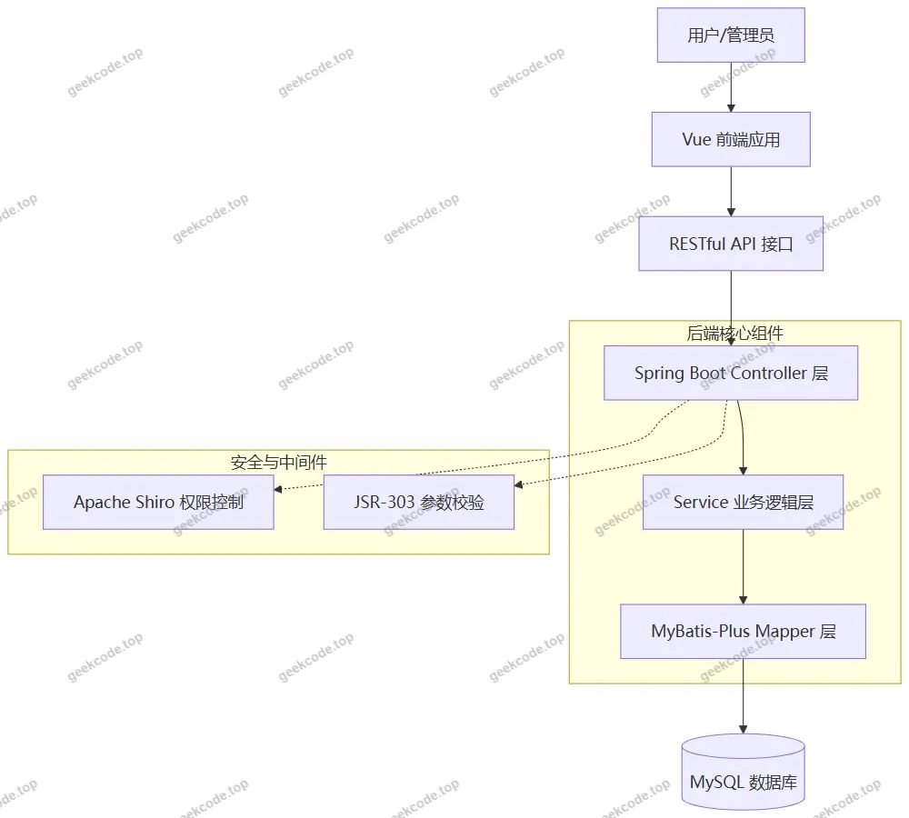</a>

<h3>2. 核心技术选型理由</h3>
<ul>
<li><strong>后端框架 (Spring Boot)</strong>：利用其自动配置和起步依赖特性，快速搭建轻量级 Web 服务，简化了 XML 配置，提高了开发效率和维护性。</li>
<li><strong>ORM 框架 (MyBatis-Plus)</strong>：在 MyBatis 基础上增强，提供了通用的 CRUD 操作接口，减少了大量样板代码，同时保留了灵活编写复杂 SQL 的能力，适合处理复杂的业务查询。</li>
<li><strong>安全框架 (Apache Shiro)</strong>：用于处理身份认证（Authentication）、授权（Authorization）和会话管理。鉴于项目包含前台用户注册登录及后台管理员多角色权限控制，Shiro 提供了细粒度的权限拦截机制，确保只有授权用户才能访问特定资源（如 <code>/admin</code> 路由下的管理功能）。</li>
<li><strong>数据库 (MySQL)</strong>：作为主流的关系型数据库，稳定可靠，支持事务处理，满足电商类应用对数据一致性的高要求。</li>
<li><strong>通信协议</strong>：前后端通过 JSON 格式数据进行交互，使用 HTTP/HTTPS 协议，确保数据传输的标准化与安全性。</li>
</ul>
<h3>3. 数据库设计要点</h3>

根据 Controller 列表推断，系统主要实体包括：用户 (<code>yonghu</code>)、商品信息 (<code>shangpinxinxi</code>)、商品分类 (<code>shangpinfenlei</code>)、订单 (<code>orders</code>)、地址 (<code>address</code>)、收藏 (<code>storeup</code>)、评论 (<code>discussshangpinxinxi</code>)、评价 (<code>shangpinpingjia</code>)、新闻/展览 (<code>news</code>)、申请 (<code>shenqing</code>)、聊天 (<code>chat</code>) 及配置 (<code>config</code>)。

<ul>
<li><strong>主键策略</strong>：各表均设有唯一标识符 ID。</li>
<li><strong>关联关系</strong>：</li>
<li><code>orders</code> 表关联 <code>user_id</code> 和 <code>product_id</code>。</li>
<li><code>discussshangpinxinxi</code> 和 <code>shangpinpingjia</code> 表通过外键关联具体的商品和用户，形成一对多关系。</li>
<li><code>storeup</code> 表记录用户与商品的收藏关系。</li>
<li><strong>索引优化</strong>：针对高频查询字段（如商品名称、分类ID、订单状态）建立索引以提升检索速度。</li>
</ul>
<h2>功能模块</h2>
<h3>1. 前台用户端功能</h3>

前台界面面向普通访客及注册用户，侧重于内容展示与交互体验。

<ul>
<li><strong>首页与导航</strong></li>
<li><strong>首页展示</strong>：轮播图、推荐商品、最新非遗展览入口。</li>
<li><strong>全局导航</strong>：包含“商品信息”、“传承人展示”、“非物质文化展览”三大核心板块。</li>
<li><strong>用户认证模块</strong></li>
<li><strong>注册与登录</strong>：新用户需填写基本信息注册，老用户通过账号密码登录。集成 Shiro 进行身份验证。</li>
<li><strong>内容浏览模块</strong></li>
<li><strong>非物质文化展览</strong>：以列表形式展示展览详情，支持点击进入详情页查看图文介绍。</li>
<li><strong>传承人展示</strong>：展示甘肃地区非遗传承人的生平、技艺及代表作品。</li>
<li><strong>商品信息浏览</strong>：</li>
<li><strong>分类筛选</strong>：通过“商品分类列表”按类别查找商品。</li>
<li><strong>详情查看</strong>：展示商品图片、价格、库存、详细描述及用户评价摘要。</li>
<li><strong>搜索功能</strong>：支持关键词检索商品。</li>
<li><strong>互动与交易模块</strong></li>
<li><strong>购物车</strong>：添加商品至购物车，修改数量，删除条目，结算前预览。</li>
<li><strong>下单流程</strong>：确认收货地址、选择支付方式、提交订单。</li>
<li><strong>评论与评价</strong>：</li>
<li><strong>商品评论</strong>：用户对已购或未购商品发表文字评论。</li>
<li><strong>商品评价</strong>：针对已完成订单的商品进行星级打分及详细评价。</li>
<li><strong>在线客服</strong>：通过“客服聊天”模块与管理员或客服人员实时沟通，咨询商品或非遗相关问题。</li>
<li><strong>个人中心模块</strong></li>
<li><strong>个人信息管理</strong>：修改头像、昵称、联系方式等。</li>
<li><strong>我的订单</strong>：查看待支付、已发货、已完成、已取消等状态的订单列表及详情。</li>
<li><strong>我的地址</strong>：新增、编辑、删除收货地址，设置默认地址。</li>
<li><strong>我的收藏</strong>：查看已收藏的商品列表，支持取消收藏。</li>
</ul>
<h3>2. 后台管理端功能</h3>

后台界面面向管理员，侧重于数据维护、业务审批及系统配置。

<ul>
<li><strong>系统基础管理</strong></li>
<li><strong>后台登录</strong>：管理员专用登录入口，具备严格的权限校验。</li>
<li><strong>配置文件管理</strong>：管理系统的基本参数，如网站标题、Logo、公告栏信息等。</li>
<li><strong>内容管理模块</strong></li>
<li><strong>非物质文化展览管理</strong>：发布、编辑、删除展览资讯，上传图片及富文本内容。</li>
<li><strong>商品信息管理</strong>：</li>
<li><strong>商品录入</strong>：添加新商品，设置名称、价格、库存、所属分类、封面图等。</li>
<li><strong>上下架控制</strong>：控制商品在前台的可见性。</li>
<li><strong>分类管理</strong>：维护商品分类树结构。</li>
<li><strong>用户管理</strong>：查看注册用户列表，重置密码，禁用违规账号。</li>
<li><strong>业务运营模块</strong></li>
<li><strong>订单管理</strong>：</li>
<li><strong>订单查询</strong>：按状态（全部、未支付、已支付等）筛选订单。</li>
<li><strong>发货处理</strong>：更新物流单号，改变订单状态。</li>
<li><strong>退款/售后</strong>：处理用户的退款申请（对应 <code>/shenqing</code> 路由中的申请类型）。</li>
<li><strong>评论与评价审核</strong>：</li>
<li><strong>商品信息评论管理</strong>：查看、删除不良评论。</li>
<li><strong>商品评价管理</strong>：监控用户评分情况，回复官方评价。</li>
<li><strong>客服聊天管理</strong>：管理员可查看并回复前台用户的在线咨询消息。</li>
<li><strong>数据统计与分析</strong></li>
<li><strong>后台首页仪表盘</strong>：展示关键指标，如今日订单数、新增用户数、热销商品排行等（基于现有路由推断，具体图表样式依前端实现而定）。</li>
</ul>
<h2>用户角色与权限</h2>

系统基于 Apache Shiro 框架实现 RBAC（基于角色的访问控制）模型，主要划分两类角色：

<table>
<thead>
<tr>
<th align="left">角色</th>
<th align="left">描述</th>
<th align="left">权限范围</th>
</tr>
</thead>
<tbody><tr>
<td align="left"><strong>普通用户</strong></td>
<td align="left">前台注册的消费者或文化爱好者</td>
<td align="left">1. <strong>浏览权限</strong>：访问所有公开的前台页面（首页、展览、商品、传承人）。2. <strong>交互权限</strong>：发表评论、参与评价、发送客服消息。3. <strong>个人数据权限</strong>：仅能查看和管理自己的订单、地址、收藏和个人信息。4. <strong>交易权限</strong>：加入购物车、创建订单、发起售后申请。</td>
</tr>
<tr>
<td align="left"><strong>管理员</strong></td>
<td align="left">后台系统的运维人员或商家管理者</td>
<td align="left">1. <strong>全量数据访问</strong>：查看所有用户信息、所有订单、所有评论内容。2. <strong>内容增删改查</strong>：发布展览资讯、上架/下架商品、管理商品分类。3. <strong>业务处理</strong>：审核用户申请（如退款、入驻申请等）、处理订单发货、回复客服消息。4. <strong>系统配置</strong>：修改网站全局配置参数。5. <strong>权限隔离</strong>：无法直接模拟普通用户进行购物操作，但可代为管理用户数据。</td>
</tr>
</tbody></table>

<strong>权限控制细节：</strong>

<ul>
<li>前台路由 <code>/news</code>, <code>/shangpinxinxi</code> 等对游客开放浏览，但对 <code>/myOrder</code>, <code>/address</code> 等个人中心路由强制要求登录态。</li>
<li>后台路由 <code>/admin/*</code> 系列（如 <code>/orders/:status</code>, <code>/yonghu</code>）仅允许拥有 <code>admin</code> 角色的用户访问，未登录或非管理员用户将被重定向至登录页或返回 403 Forbidden。</li>
</ul>
<h2>项目特色与创新点</h2>
<ol>
<li>
<strong>“文化+电商”深度融合模式</strong>：
   不同于传统的纯电商平台或纯资讯网站，本项目将“非物质文化展览”、“传承人展示”与“商品信息”有机结合。用户在浏览甘肃非遗故事的同时，可直接购买相关的文创产品或特产，实现了从文化认知到消费转化的闭环，有效促进了地方文化的传播与经济价值变现。

</li>
<li>
<strong>多维度的用户互动体系</strong>：
   引入了“客服聊天” (<code>ChatController</code>) 和双重反馈机制（“商品信息评论”与“商品评价”）。评论侧重于商品本身的讨论，评价侧重于交易后的满意度打分，这种分层设计有助于更精准地收集用户反馈，提升服务质量。

</li>
<li>
<strong>精细化的权限与安全管控</strong>：
   采用 Shiro 框架而非简单的 Session 判断，实现了更细粒度的权限控制。结合 MyBatis-Plus 的参数绑定机制，有效防止 SQL 注入风险；通过 JSR-303 Validation 进行严格的前后端参数校验，保障了数据的完整性和系统的安全性。

</li>
<li>
<strong>模块化与可扩展性</strong>：
   后端采用标准的 RESTful 风格接口设计，Controller 层职责单一清晰（如独立的 AddressController, CartController），便于后续增加新功能（如直播带货、VR看展）而不影响原有业务逻辑。

</li>
</ol>
<h2>部署环境</h2>

为确保系统正常运行，需准备以下软件及硬件环境：

<h3>1. 硬件要求</h3>
<ul>
<li><strong>CPU</strong>: Intel Core i5 及以上或同等性能处理器。</li>
<li><strong>内存</strong>: 至少 8GB RAM（建议 16GB 以流畅运行 MySQL 和 Java 进程）。</li>
<li><strong>硬盘</strong>: 至少 50GB 可用空间（用于存储代码、数据库文件及上传的图片资源）。</li>
</ul>
<h3>2. 软件环境</h3>
<ul>
<li><strong>操作系统</strong>: Windows 10/11, macOS 或 Linux (CentOS 7+, Ubuntu 20.04+)。</li>
<li><strong>Java 运行环境</strong>: JDK 1.8 或更高版本（推荐 OpenJDK 8 或 Oracle JDK 8/11）。</li>
<li><strong>数据库</strong>: MySQL 5.7 或 MySQL 8.0 社区版。需开启远程连接权限（若前后端分离部署在不同机器）。</li>
<li><strong>Node.js</strong>: 用于编译 Vue 前端项目，建议版本 v14.x 或 v16.x LTS。</li>
<li><strong>包管理器</strong>: Maven (用于后端依赖管理), npm 或 yarn (用于前端依赖管理)。</li>
</ul>
<h3>3. 开发工具（可选，用于二次开发）</h3>
<ul>
<li><strong>IDE</strong>: IntelliJ IDEA (推荐) 或 Eclipse。</li>
<li><strong>编辑器</strong>: VS Code (用于 Vue 前端开发)。</li>
<li><strong>数据库客户端</strong>: Navicat Premium 或 DBeaver。</li>
</ul>
<h3>4. 部署步骤简述</h3>
<ol>
<li><strong>数据库初始化</strong>: 安装 MySQL，创建数据库，执行提供的 SQL 脚本导入表结构和初始数据。</li>
<li><strong>后端启动</strong>: 配置 <code>application.yml</code> 中的数据库连接 URL、用户名和密码。使用 Maven 打包 (<code>mvn clean package</code>)，生成 jar 包后通过 <code>java -jar xxx.jar</code> 启动服务。</li>
<li><strong>前端启动</strong>: 进入前端项目目录，执行 <code>npm install</code> 安装依赖，然后执行 <code>npm run serve</code> (开发模式) 或 <code>npm run build</code> (生产模式)。生产模式下生成的静态文件可部署于 Nginx 或直接由 Spring Boot 托管（若配置了静态资源映射）。</li>
<li><strong>联调测试</strong>: 访问前端地址，检查 API 请求是否成功返回数据，验证登录及核心业务流程。</li>
</ol>
<h2>五、技术特性</h2>
<ul>
<li>前后端集成部署，前端资源打包至后端 static 目录</li>
<li>使用 MyBatis-Plus 简化数据访问层开发</li>
<li>集成 Shiro 权限框架实现角色权限控制</li>
</ul>
<h2>六、功能模块截图</h2>
<h3>前台用户端</h3>
<h4>前台首页</h4>

<a href="https://geekcode.top/archives/%E7%94%98%E8%82%83%E9%9D%9E%E7%89%A9%E8%B4%A8%E6%96%87%E5%8C%96%E7%BD%91%E7%AB%99%E7%9A%84%E8%AE%BE%E8%AE%A1%E4%B8%8E%E5%BC%80%E5%8F%91?utm_source=github" title="查看完整源码">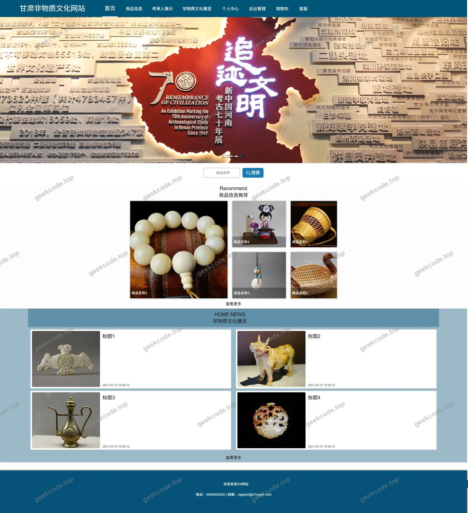</a>

<h4>前台登录页</h4>

<h4>前台注册页</h4>

<h4>前台-非物质文化展览列表</h4>

<a href="https://geekcode.top/archives/%E7%94%98%E8%82%83%E9%9D%9E%E7%89%A9%E8%B4%A8%E6%96%87%E5%8C%96%E7%BD%91%E7%AB%99%E7%9A%84%E8%AE%BE%E8%AE%A1%E4%B8%8E%E5%BC%80%E5%8F%91?utm_source=github" title="查看完整源码">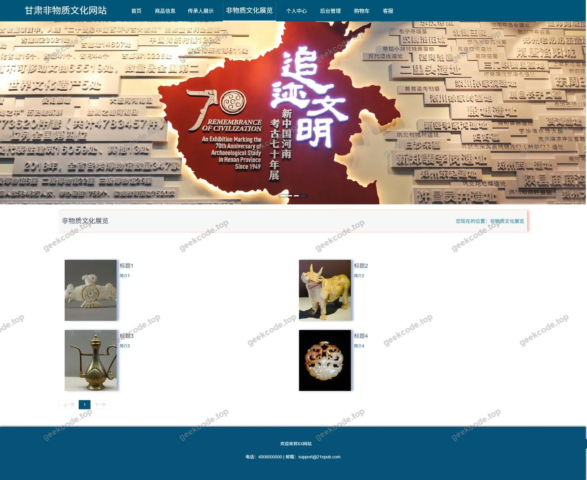</a>

<h4>前台-商品信息列表</h4>

<a href="https://geekcode.top/archives/%E7%94%98%E8%82%83%E9%9D%9E%E7%89%A9%E8%B4%A8%E6%96%87%E5%8C%96%E7%BD%91%E7%AB%99%E7%9A%84%E8%AE%BE%E8%AE%A1%E4%B8%8E%E5%BC%80%E5%8F%91?utm_source=github" title="查看完整源码">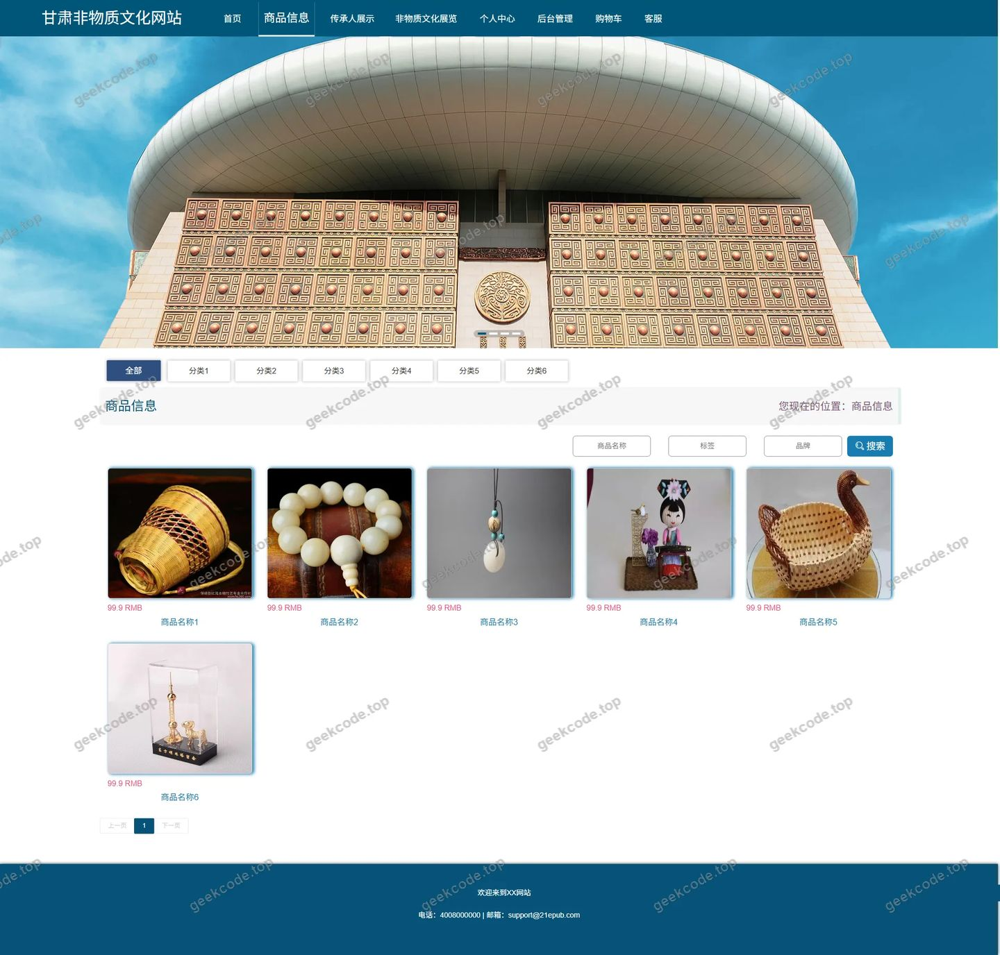</a>

<h4>前台-商品信息评论列表</h4>

<a href="https://geekcode.top/archives/%E7%94%98%E8%82%83%E9%9D%9E%E7%89%A9%E8%B4%A8%E6%96%87%E5%8C%96%E7%BD%91%E7%AB%99%E7%9A%84%E8%AE%BE%E8%AE%A1%E4%B8%8E%E5%BC%80%E5%8F%91?utm_source=github" title="查看完整源码">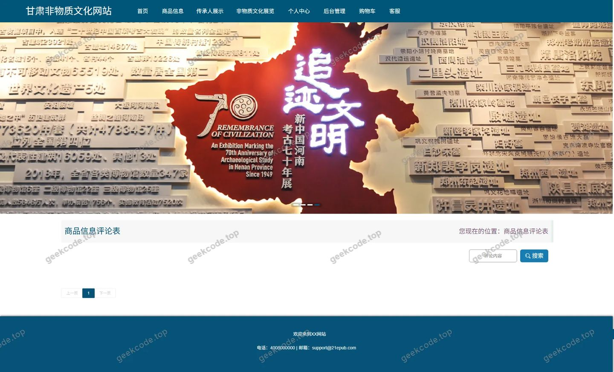</a>

<h4>前台-商品评价列表</h4>

<h4>前台个人中心</h4>

<a href="https://geekcode.top/archives/%E7%94%98%E8%82%83%E9%9D%9E%E7%89%A9%E8%B4%A8%E6%96%87%E5%8C%96%E7%BD%91%E7%AB%99%E7%9A%84%E8%AE%BE%E8%AE%A1%E4%B8%8E%E5%BC%80%E5%8F%91?utm_source=github" title="查看完整源码">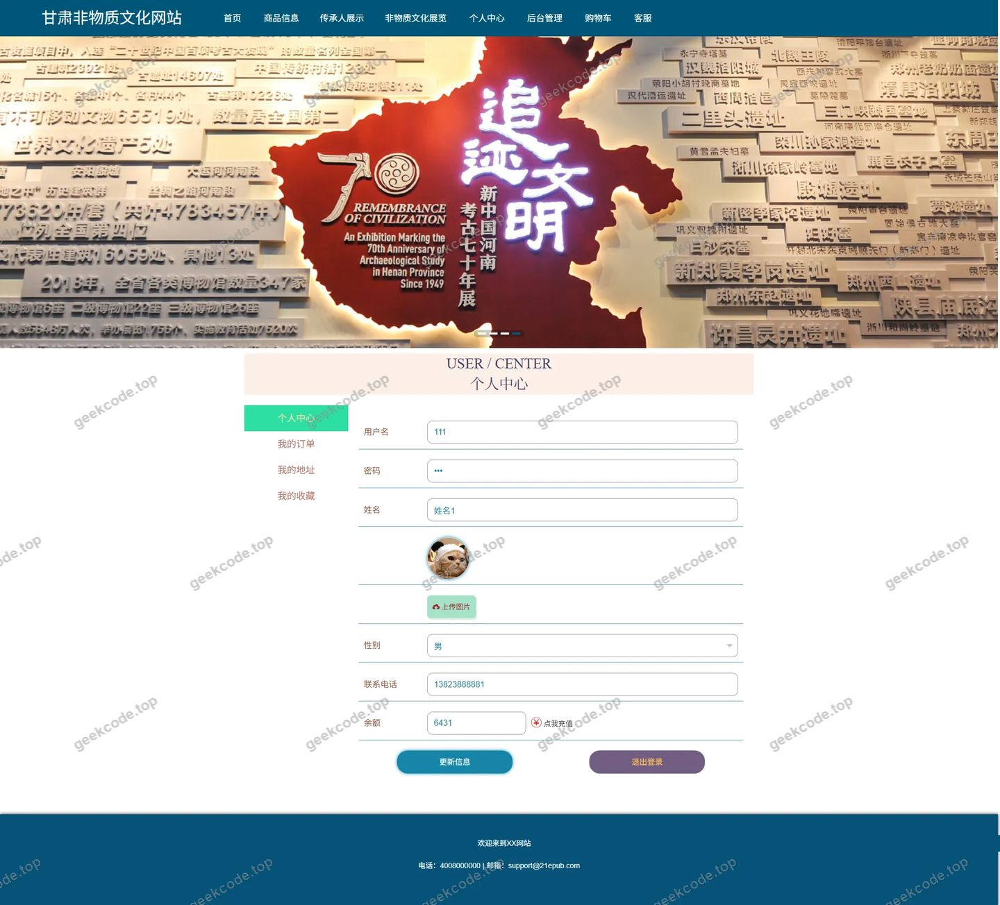</a>

<h4>前台-我的地址列表</h4>

<a href="https://geekcode.top/archives/%E7%94%98%E8%82%83%E9%9D%9E%E7%89%A9%E8%B4%A8%E6%96%87%E5%8C%96%E7%BD%91%E7%AB%99%E7%9A%84%E8%AE%BE%E8%AE%A1%E4%B8%8E%E5%BC%80%E5%8F%91?utm_source=github" title="查看完整源码">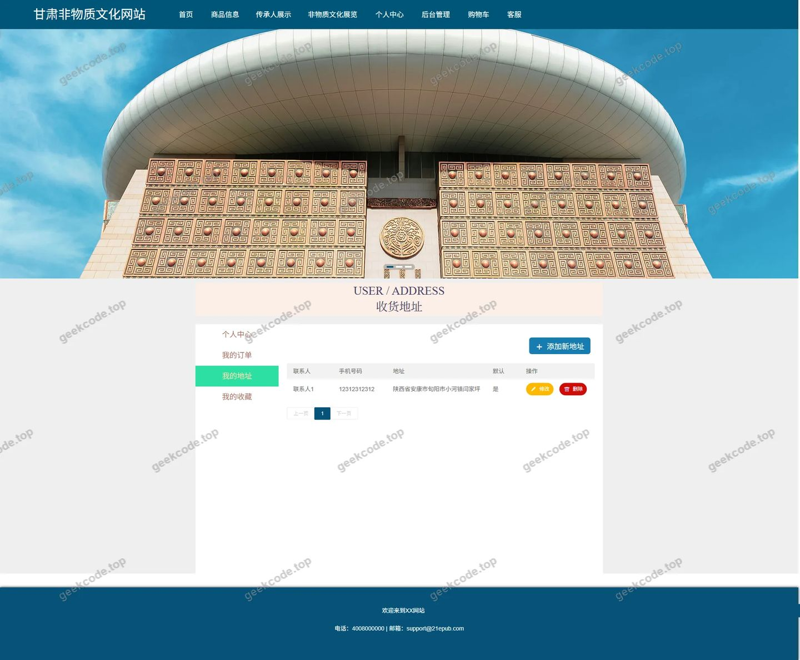</a>

<h4>前台-我的订单列表</h4>

<a href="https://geekcode.top/archives/%E7%94%98%E8%82%83%E9%9D%9E%E7%89%A9%E8%B4%A8%E6%96%87%E5%8C%96%E7%BD%91%E7%AB%99%E7%9A%84%E8%AE%BE%E8%AE%A1%E4%B8%8E%E5%BC%80%E5%8F%91?utm_source=github" title="查看完整源码">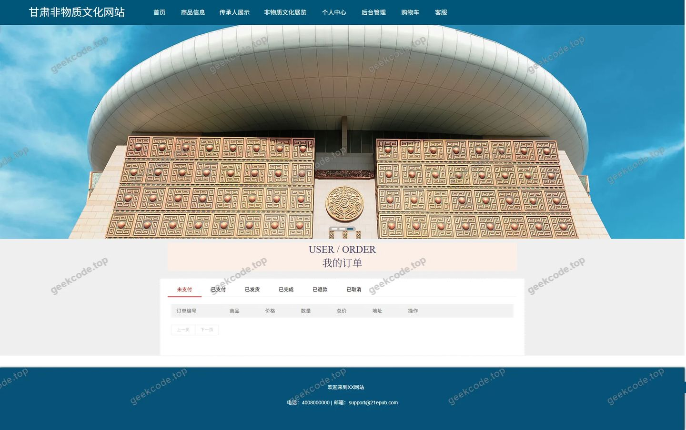</a>

<h4>前台-我的收藏列表</h4>

<a href="https://geekcode.top/archives/%E7%94%98%E8%82%83%E9%9D%9E%E7%89%A9%E8%B4%A8%E6%96%87%E5%8C%96%E7%BD%91%E7%AB%99%E7%9A%84%E8%AE%BE%E8%AE%A1%E4%B8%8E%E5%BC%80%E5%8F%91?utm_source=github" title="查看完整源码">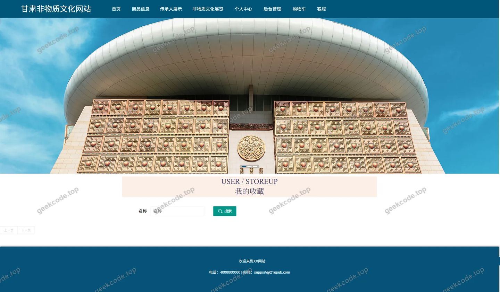</a>

<h4>前台-非物质文化展览-详情</h4>

<a href="https://geekcode.top/archives/%E7%94%98%E8%82%83%E9%9D%9E%E7%89%A9%E8%B4%A8%E6%96%87%E5%8C%96%E7%BD%91%E7%AB%99%E7%9A%84%E8%AE%BE%E8%AE%A1%E4%B8%8E%E5%BC%80%E5%8F%91?utm_source=github" title="查看完整源码">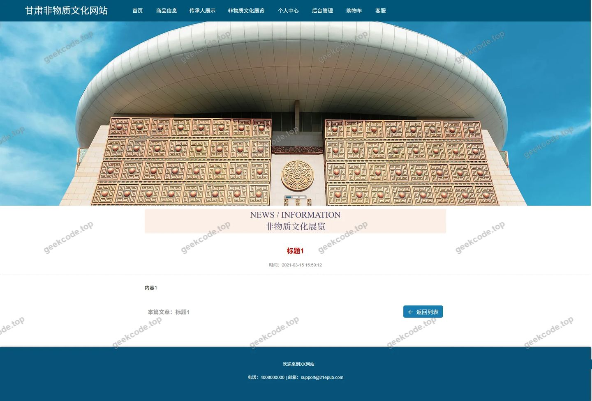</a>

<h4>前台-商品信息-详情</h4>

<a href="https://geekcode.top/archives/%E7%94%98%E8%82%83%E9%9D%9E%E7%89%A9%E8%B4%A8%E6%96%87%E5%8C%96%E7%BD%91%E7%AB%99%E7%9A%84%E8%AE%BE%E8%AE%A1%E4%B8%8E%E5%BC%80%E5%8F%91?utm_source=github" title="查看完整源码">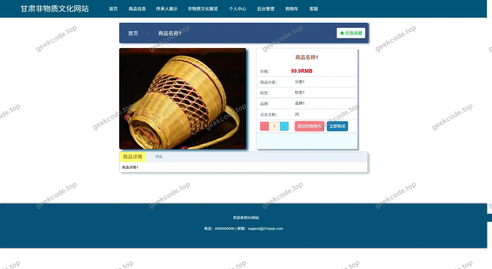</a>

<h4>前台-商品分类列表</h4>

<a href="https://geekcode.top/archives/%E7%94%98%E8%82%83%E9%9D%9E%E7%89%A9%E8%B4%A8%E6%96%87%E5%8C%96%E7%BD%91%E7%AB%99%E7%9A%84%E8%AE%BE%E8%AE%A1%E4%B8%8E%E5%BC%80%E5%8F%91?utm_source=github" title="查看完整源码">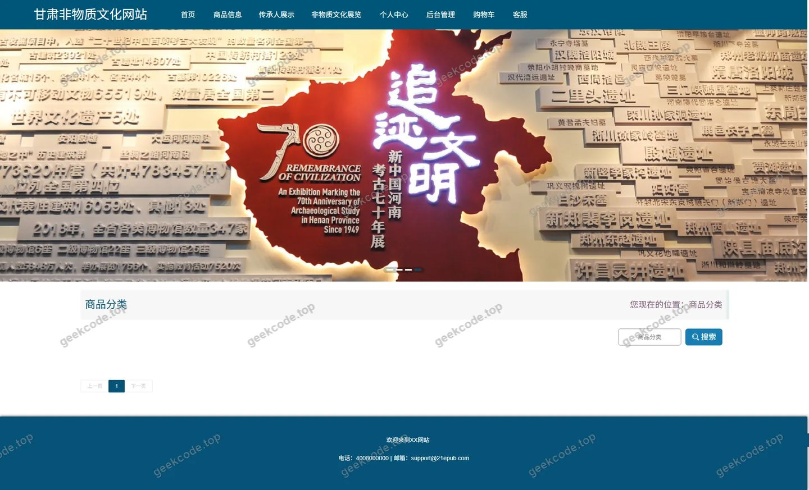</a>

<h4>前台-购物车列表</h4>

<a href="https://geekcode.top/archives/%E7%94%98%E8%82%83%E9%9D%9E%E7%89%A9%E8%B4%A8%E6%96%87%E5%8C%96%E7%BD%91%E7%AB%99%E7%9A%84%E8%AE%BE%E8%AE%A1%E4%B8%8E%E5%BC%80%E5%8F%91?utm_source=github" title="查看完整源码">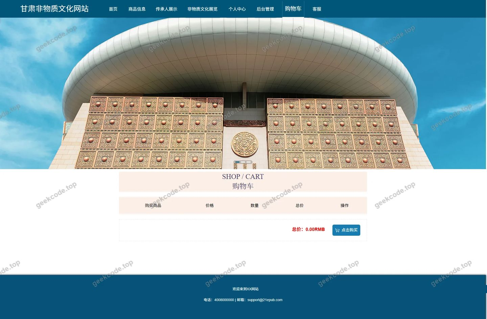</a>

<h4>前台-商品信息评论-详情</h4>

<a href="https://geekcode.top/archives/%E7%94%98%E8%82%83%E9%9D%9E%E7%89%A9%E8%B4%A8%E6%96%87%E5%8C%96%E7%BD%91%E7%AB%99%E7%9A%84%E8%AE%BE%E8%AE%A1%E4%B8%8E%E5%BC%80%E5%8F%91?utm_source=github" title="查看完整源码">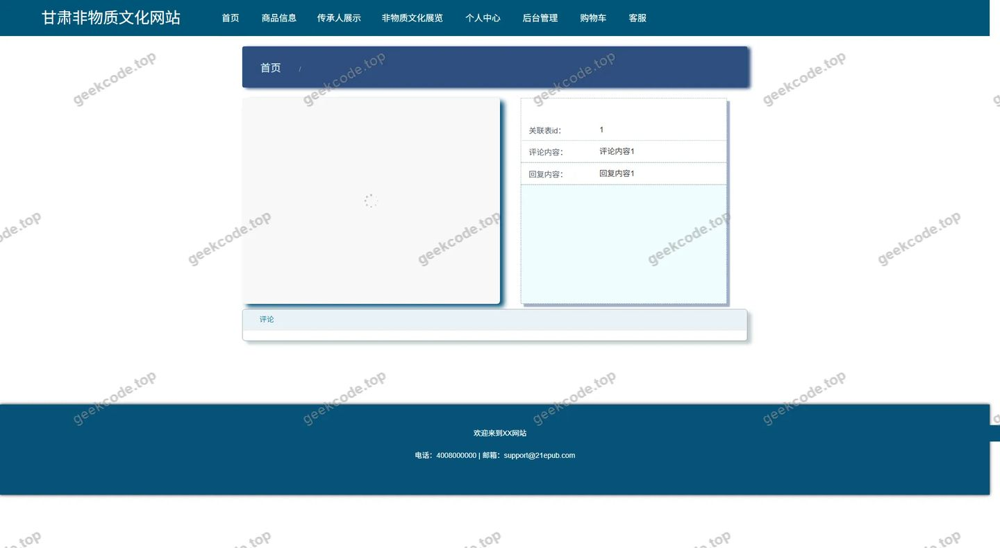</a>

<h4>前台-商品分类-详情</h4>

<a href="https://geekcode.top/archives/%E7%94%98%E8%82%83%E9%9D%9E%E7%89%A9%E8%B4%A8%E6%96%87%E5%8C%96%E7%BD%91%E7%AB%99%E7%9A%84%E8%AE%BE%E8%AE%A1%E4%B8%8E%E5%BC%80%E5%8F%91?utm_source=github" title="查看完整源码">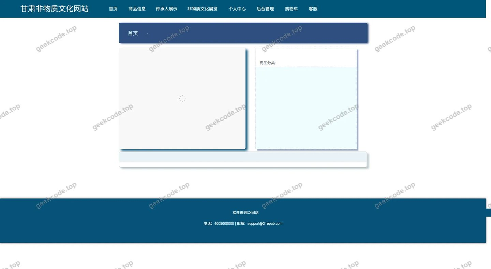</a>

<h4>前台-商品评价-详情</h4>

<a href="https://geekcode.top/archives/%E7%94%98%E8%82%83%E9%9D%9E%E7%89%A9%E8%B4%A8%E6%96%87%E5%8C%96%E7%BD%91%E7%AB%99%E7%9A%84%E8%AE%BE%E8%AE%A1%E4%B8%8E%E5%BC%80%E5%8F%91?utm_source=github" title="查看完整源码">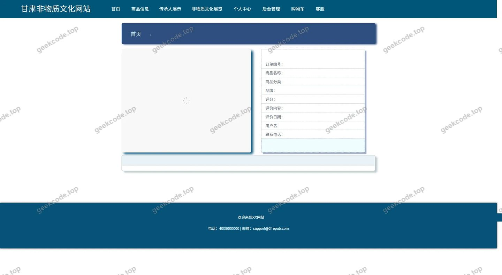</a>

<h4>前台-客服聊天</h4>

<a href="https://geekcode.top/archives/%E7%94%98%E8%82%83%E9%9D%9E%E7%89%A9%E8%B4%A8%E6%96%87%E5%8C%96%E7%BD%91%E7%AB%99%E7%9A%84%E8%AE%BE%E8%AE%A1%E4%B8%8E%E5%BC%80%E5%8F%91?utm_source=github" title="查看完整源码">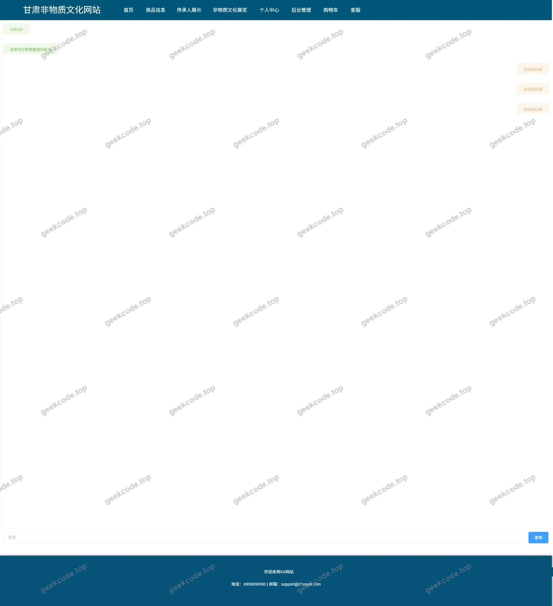</a>

<h3>后台管理端</h3>
<h4>后台-在线客服</h4>

<a href="https://geekcode.top/archives/%E7%94%98%E8%82%83%E9%9D%9E%E7%89%A9%E8%B4%A8%E6%96%87%E5%8C%96%E7%BD%91%E7%AB%99%E7%9A%84%E8%AE%BE%E8%AE%A1%E4%B8%8E%E5%BC%80%E5%8F%91?utm_source=github" title="查看完整源码">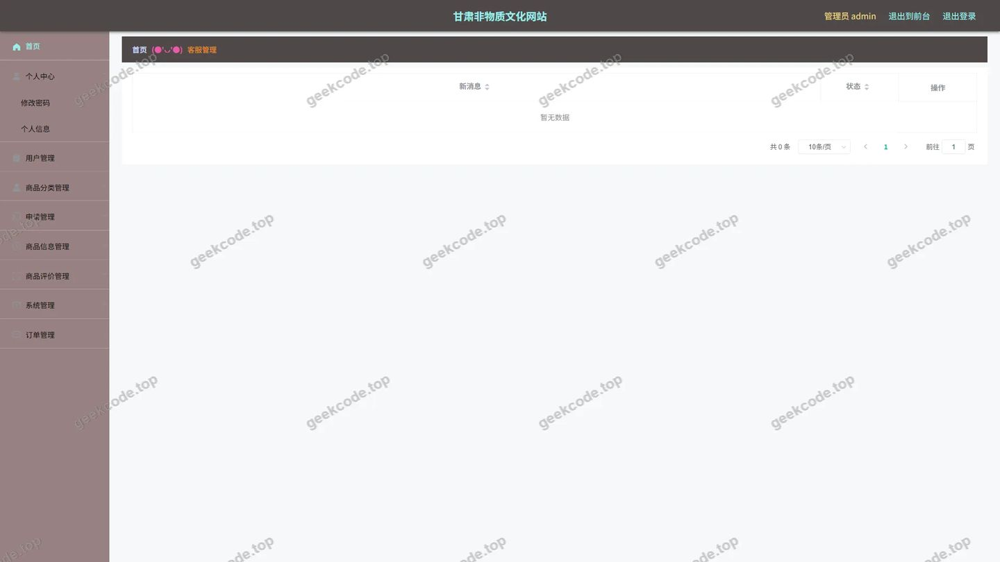</a>

<h4>后台-系统配置</h4>

<a href="https://geekcode.top/archives/%E7%94%98%E8%82%83%E9%9D%9E%E7%89%A9%E8%B4%A8%E6%96%87%E5%8C%96%E7%BD%91%E7%AB%99%E7%9A%84%E8%AE%BE%E8%AE%A1%E4%B8%8E%E5%BC%80%E5%8F%91?utm_source=github" title="查看完整源码">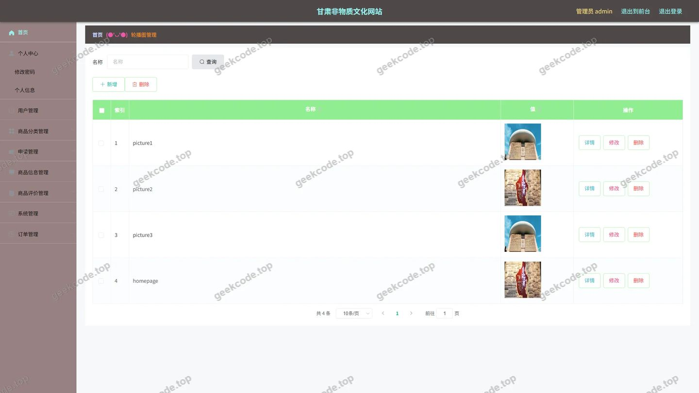</a>

<h4>后台-商品信息评论</h4>

<a href="https://geekcode.top/archives/%E7%94%98%E8%82%83%E9%9D%9E%E7%89%A9%E8%B4%A8%E6%96%87%E5%8C%96%E7%BD%91%E7%AB%99%E7%9A%84%E8%AE%BE%E8%AE%A1%E4%B8%8E%E5%BC%80%E5%8F%91?utm_source=github" title="查看完整源码">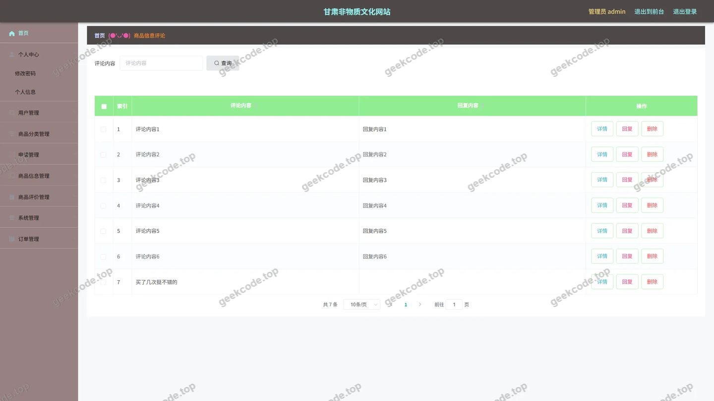</a>

<h4>后台首页</h4>

<a href="https://geekcode.top/archives/%E7%94%98%E8%82%83%E9%9D%9E%E7%89%A9%E8%B4%A8%E6%96%87%E5%8C%96%E7%BD%91%E7%AB%99%E7%9A%84%E8%AE%BE%E8%AE%A1%E4%B8%8E%E5%BC%80%E5%8F%91?utm_source=github" title="查看完整源码">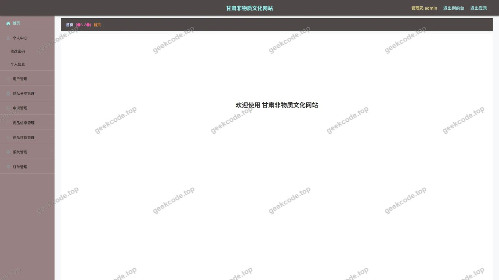</a>

<h4>后台-登录</h4>

<a href="https://geekcode.top/archives/%E7%94%98%E8%82%83%E9%9D%9E%E7%89%A9%E8%B4%A8%E6%96%87%E5%8C%96%E7%BD%91%E7%AB%99%E7%9A%84%E8%AE%BE%E8%AE%A1%E4%B8%8E%E5%BC%80%E5%8F%91?utm_source=github" title="查看完整源码">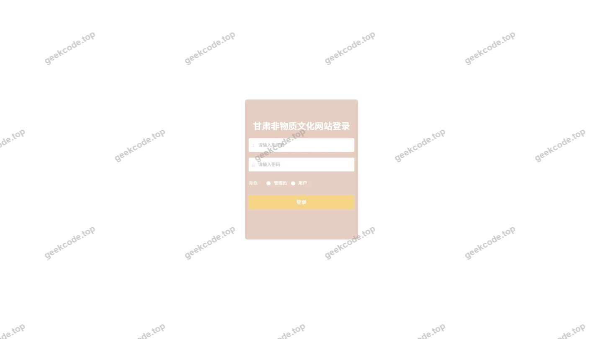</a>

<h4>后台-公告信息</h4>

<a href="https://geekcode.top/archives/%E7%94%98%E8%82%83%E9%9D%9E%E7%89%A9%E8%B4%A8%E6%96%87%E5%8C%96%E7%BD%91%E7%AB%99%E7%9A%84%E8%AE%BE%E8%AE%A1%E4%B8%8E%E5%BC%80%E5%8F%91?utm_source=github" title="查看完整源码">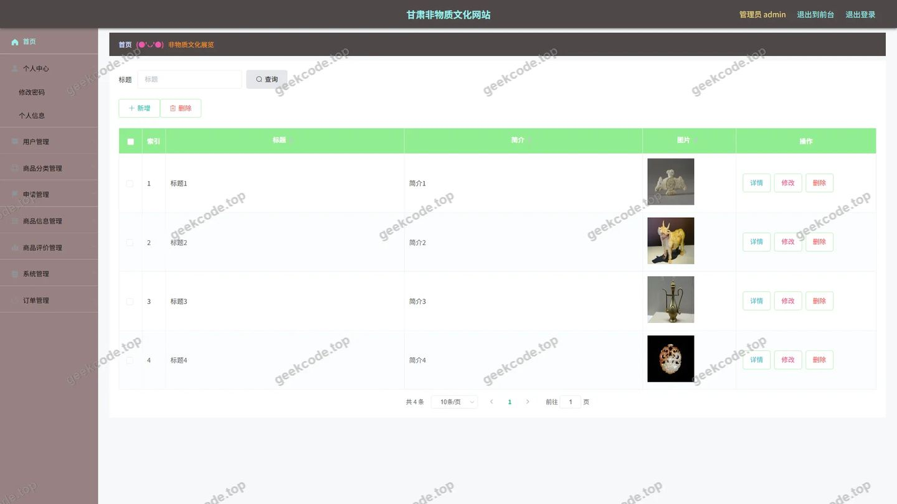</a>

<h4>后台-订单-状态</h4>

<a href="https://geekcode.top/archives/%E7%94%98%E8%82%83%E9%9D%9E%E7%89%A9%E8%B4%A8%E6%96%87%E5%8C%96%E7%BD%91%E7%AB%99%E7%9A%84%E8%AE%BE%E8%AE%A1%E4%B8%8E%E5%BC%80%E5%8F%91?utm_source=github" title="查看完整源码">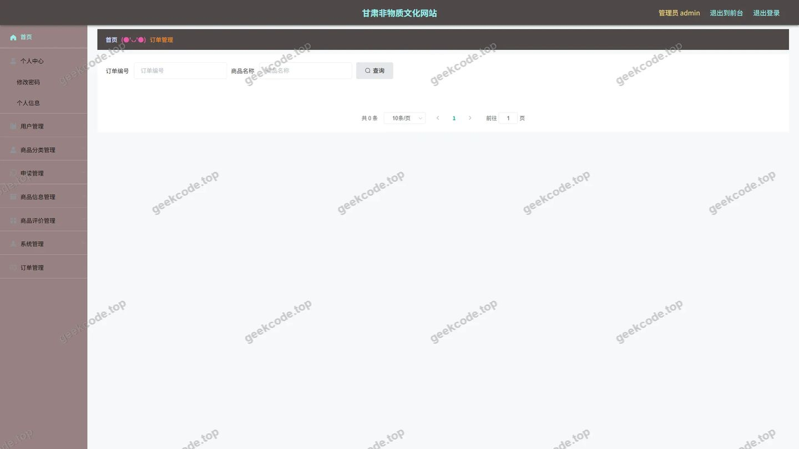</a>

<h4>后台-商品分类</h4>

<a href="https://geekcode.top/archives/%E7%94%98%E8%82%83%E9%9D%9E%E7%89%A9%E8%B4%A8%E6%96%87%E5%8C%96%E7%BD%91%E7%AB%99%E7%9A%84%E8%AE%BE%E8%AE%A1%E4%B8%8E%E5%BC%80%E5%8F%91?utm_source=github" title="查看完整源码">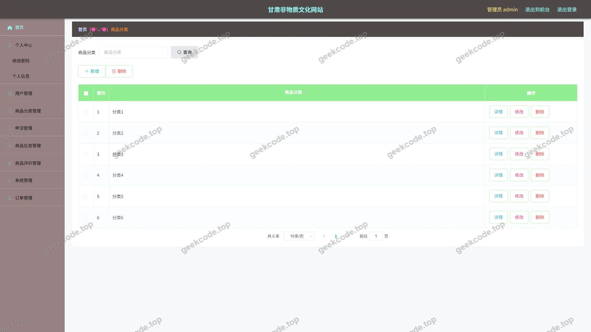</a>

<h4>后台-商品评价</h4>

<a href="https://geekcode.top/archives/%E7%94%98%E8%82%83%E9%9D%9E%E7%89%A9%E8%B4%A8%E6%96%87%E5%8C%96%E7%BD%91%E7%AB%99%E7%9A%84%E8%AE%BE%E8%AE%A1%E4%B8%8E%E5%BC%80%E5%8F%91?utm_source=github" title="查看完整源码">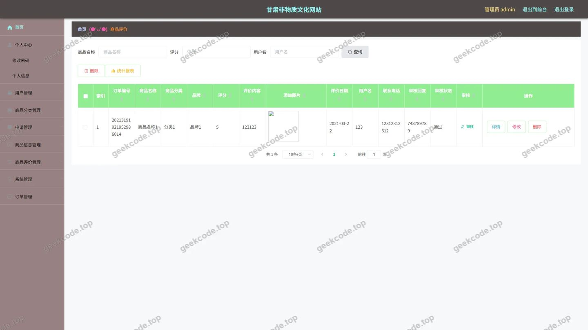</a>

<h4>后台-商品信息</h4>

<a href="https://geekcode.top/archives/%E7%94%98%E8%82%83%E9%9D%9E%E7%89%A9%E8%B4%A8%E6%96%87%E5%8C%96%E7%BD%91%E7%AB%99%E7%9A%84%E8%AE%BE%E8%AE%A1%E4%B8%8E%E5%BC%80%E5%8F%91?utm_source=github" title="查看完整源码">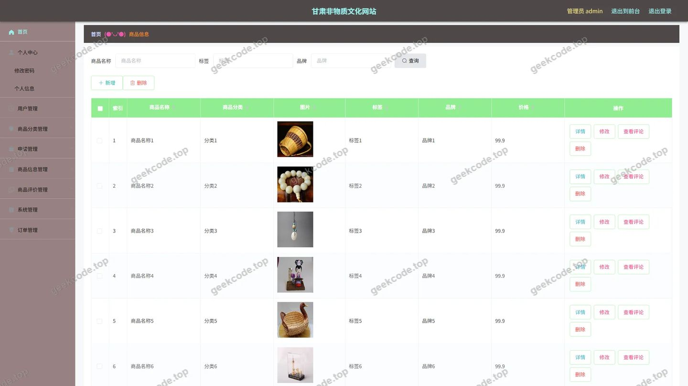</a>

<h4>后台-物资申请</h4>

<a href="https://geekcode.top/archives/%E7%94%98%E8%82%83%E9%9D%9E%E7%89%A9%E8%B4%A8%E6%96%87%E5%8C%96%E7%BD%91%E7%AB%99%E7%9A%84%E8%AE%BE%E8%AE%A1%E4%B8%8E%E5%BC%80%E5%8F%91?utm_source=github" title="查看完整源码">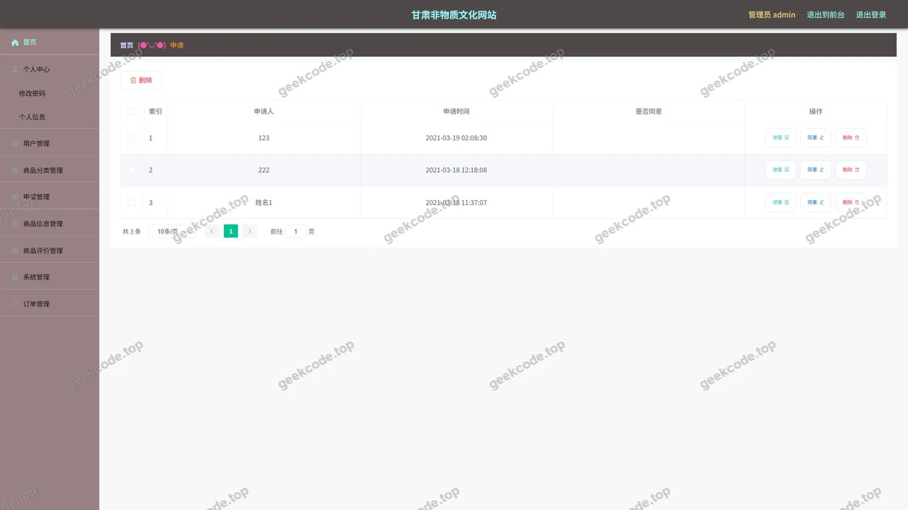</a>

<h4>后台-收藏</h4>

<a href="https://geekcode.top/archives/%E7%94%98%E8%82%83%E9%9D%9E%E7%89%A9%E8%B4%A8%E6%96%87%E5%8C%96%E7%BD%91%E7%AB%99%E7%9A%84%E8%AE%BE%E8%AE%A1%E4%B8%8E%E5%BC%80%E5%8F%91?utm_source=github" title="查看完整源码">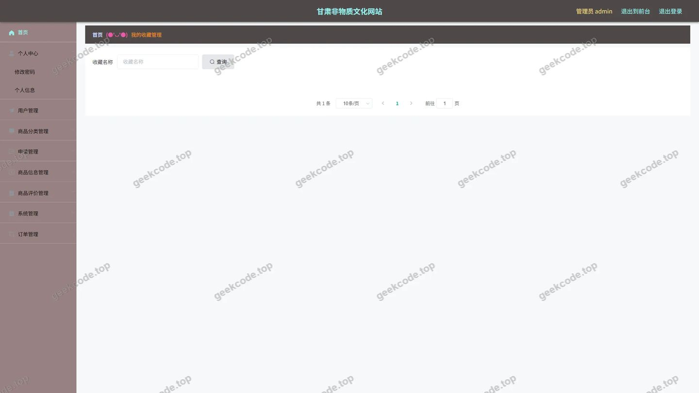</a>

---

## 获取完整源码

| 项目 | 说明 |
| --- | --- |
| 项目名 | 甘肃非物质文化网站的设计与开发 |
| 运行截图 | 本文 32 张（站点带水印原图，仓库 `images/` 目录） |
| 完整源码 | [https://geekcode.top/archives/%E7%94%98%E8%82%83%E9%9D%9E%E7%89%A9%E8%B4%A8%E6%96%87%E5%8C%96%E7%BD%91%E7%AB%99%E7%9A%84%E8%AE%BE%E8%AE%A1%E4%B8%8E%E5%BC%80%E5%8F%91?utm_source=github](https://geekcode.top/archives/%E7%94%98%E8%82%83%E9%9D%9E%E7%89%A9%E8%B4%A8%E6%96%87%E5%8C%96%E7%BD%91%E7%AB%99%E7%9A%84%E8%AE%BE%E8%AE%A1%E4%B8%8E%E5%BC%80%E5%8F%91?utm_source=github) |
| 咨询微信 | **ir9372**（备注：jingpin-yuanma） |
| 更多项目 | [极客代码 geekcode.top](https://geekcode.top/?utm_source=github) |

> 需要源码、部署、改配置、跑不起来等问题，加微信 ir9372 沟通，说明项目名即可。
